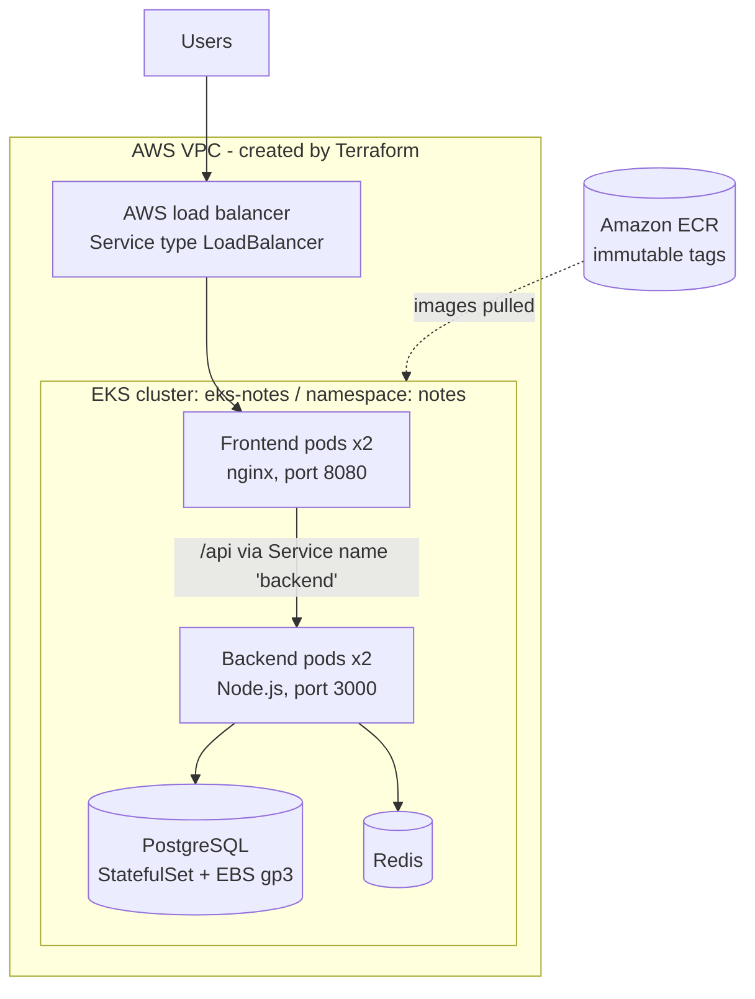
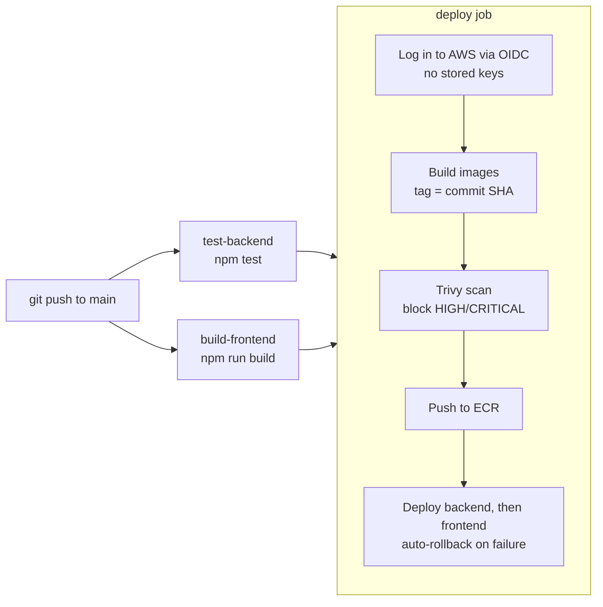

# EKS Full-Stack Notes App: DevSecOps on AWS

A full-stack notes application (React + Node.js + PostgreSQL + Redis) deployed to **Amazon EKS** with **Terraform**, **security-scanned container images**, and a **GitHub Actions CI/CD pipeline** that authenticates to AWS with **OIDC (no stored keys)**.

I built this project hands-on to learn Kubernetes and DevOps end to end, and I documented the problems I hit along the way, because that's where most of the learning happened.

> **Status:** The infrastructure is torn down when not in use to avoid AWS costs. Everything can be recreated with `terraform apply` and the steps below.

---

## Tech stack

| Area | Tools |
|---|---|
| Application | React (Vite) served by nginx, Node.js / Express API, PostgreSQL, Redis |
| Containers | Docker (multi-stage builds, non-root users), Docker Compose for local testing |
| Security | Trivy (images, dependencies, IaC, secrets), ECR scan on push, `.trivyignore` with documented exceptions |
| Infrastructure as Code | Terraform: VPC, EKS, ECR (immutable tags), IAM, GitHub OIDC role |
| Orchestration | Kubernetes on EKS: Deployments, StatefulSet, Services, ConfigMap, Secret, HPA |
| CI/CD | GitHub Actions: test → build → scan → push → deploy, with automatic rollback |

---

## Architecture



- **Only the frontend is public.** The backend, PostgreSQL and Redis are `ClusterIP` services, so they're unreachable from the internet.
- Pods talk to each other **pod → Service → pod** using Service names (`backend:3000`, `postgres:5432`, `redis:6379`).
- PostgreSQL runs as a **StatefulSet** with a persistent **EBS gp3** volume, so data survives pod restarts. (For production I'd move it to **Amazon RDS**; see lessons learned.)
- Backend and frontend each run **2 replicas** for resilience and zero-downtime rolling updates, with **HPAs** for autoscaling.

---

## CI/CD pipeline



- **Pull requests** run tests only. **Deploys happen only on push to `main`**, enforced both in the workflow and in the IAM trust policy.
- Images are tagged with the **Git commit SHA**, so every running image traces back to the exact code that built it.
- **The Trivy scan is a gate:** if a HIGH or CRITICAL vulnerability appears, nothing is pushed or deployed.
- Backend deploys **before** frontend, so a new frontend never calls an old API. A failed rollout triggers `kubectl rollout undo`.

---

## What I fixed along the way

| # | Problem | Root cause | Fix |
|---|---|---|---|
| 1 | Frontend image had **68 HIGH/CRITICAL** vulnerabilities | Base image on an **end-of-life Alpine** release that no longer gets security updates | Moved to a current `nginx-unprivileged:stable-alpine` base plus `apk upgrade` (68 → 6). The remaining 6 nginx findings were reviewed as unreachable in this configuration and documented in `.trivyignore` with a review date |
| 2 | Backend image had **6 HIGH** findings | All inside **npm itself**, shipped with the Node base image but unused at runtime | Removed npm, npx, yarn and corepack from the final image stage (6 → 0) |
| 3 | Frontend build broke after `npm audit fix --force` | Vite was upgraded to a major version the React plugin didn't support yet (peer dependency conflict) | Upgraded `@vitejs/plugin-react` to match. Lesson: always rebuild and test right after a `--force` fix |
| 4 | ECR scan said `ScanNotFoundException` / `UnsupportedImageError` | Modern Docker pushes a **bundle** (index + image + provenance attestation). ECR basic scanning can't scan the index or attestation | Build with `--provenance=false` so a single, scannable image is pushed |
| 5 | Fixed images couldn't reuse their tag | ECR repositories use **immutable tags** | Pushed fixes as new versions (`v1` → `v2` → `v3`). The pipeline now uses commit SHAs |
| 6 | Pods stuck in `CreateContainerConfigError` | The `postgres-secret` didn't exist. It's deliberately kept out of Git | Created it directly in the cluster with `kubectl create secret` and a generated password |
| 7 | Pods refused to start: *"image has non-numeric user"* | Manifests set `runAsNonRoot: true`, but the images used **named** users (`node`, `nginx`), which Kubernetes can't verify | Switched to **numeric** users: `USER 1000` (backend), `USER 101` (frontend) |
| 8 | Website timed out from the internet, though all targets were healthy | The load balancer was provisioned as **internal** (private IPs only) | Added `service.beta.kubernetes.io/aws-load-balancer-scheme: internet-facing` to the frontend Service |
| 9 | `kubectl` failed with *"no such host"* after rebuilding | kubeconfig still pointed at the **deleted** cluster | Re-run `aws eks update-kubeconfig` after every cluster rebuild |
| 10 | Pipeline failed: action version not found | A pinned third-party action tag didn't exist | Ran Trivy from its official Docker image instead, removing the action dependency |
| 11 | Pipeline refused by AWS: *"Not authorized to perform sts:AssumeRoleWithWebIdentity"* | The repo uses GitHub's **immutable OIDC subject** (`owner@<id>/repo@<id>`), but the IAM trust policy expected the name-only format | Updated the trust policy's `sub` condition to the immutable format, which also protects against repo-name takeover |

---

## Security measures

- **No long-lived AWS keys** in the pipeline or the cluster: GitHub Actions uses **OIDC**, scoped to this repository's `main` branch.
- **Least privilege:** separate IAM roles per component, each with a trust policy limiting who can use it.
- **Shift-left scanning:** Trivy locally, Trivy as a pipeline gate, and ECR scan on push as a second layer.
- **Non-root containers** with numeric UIDs, enforced by `runAsNonRoot: true`.
- **Minimal runtime images:** multi-stage builds. Package managers are removed from the final backend image.
- **Secrets stay out of Git:** the database password lives only in a Kubernetes Secret, and `.gitignore` excludes keys, `.tfvars` and Terraform state.
- **Only one public entry point:** everything except the frontend is `ClusterIP`.

---

## Lessons learned

1. **`kubectl describe pod` explains most failures.** The Events section named the missing Secret and the non-numeric user in plain words.
2. **Check what you're scanning.** Trivy's `Detected OS` line showed when I was accidentally scanning an old image.
3. **Base images age.** Rebuild regularly with `--pull`, even when the code hasn't changed.
4. **Ship only what runs.** Build tools left in an image (npm) are attack surface.
5. **Healthy targets but no connection means a network problem, not an app problem.** Check DNS, then the load balancer scheme, then target health.
6. **`kubectl diff` before `kubectl apply`**, just like `terraform plan` before `terraform apply`. It stopped me from deploying a broken file after I'd accidentally wiped it.
7. **Git is a safety net.** A deleted file is one `git checkout` away from recovery.
8. **Delete Kubernetes-created resources before `terraform destroy`.** Load balancers and EBS volumes created by Kubernetes aren't in Terraform's state and block VPC deletion.
9. **In-cluster databases are fine for learning; RDS is safer for production** (automatic backups, Multi-AZ failover, managed patching).
10. **OIDC trust policies must match the token exactly**, including GitHub's newer immutable subject format.

---

## Possible next steps

- Move PostgreSQL to **Amazon RDS** and Redis to **ElastiCache**
- Expose the app through an **Ingress + AWS Load Balancer Controller (ALB)** with HTTPS
- Add **GitOps** (Argo CD) so the cluster always matches the manifests in Git
- Enable the included **Prometheus/Grafana** monitoring and add load testing for the HPAs
- Pin GitHub Actions to commit SHAs for stronger supply-chain security

---

*The original setup instructions follow below.*

---

# Build, Scale & Monitor a 4-Service App on Amazon EKS

A hands-on project with a **Notes app** made of four services:

| Service | Technology | Job | Public? |
|---|---|---|---|
| **Frontend** | React (built with Vite), served by Nginx | The web page users see; forwards `/api` calls to the backend | ✅ Yes — the only public service |
| **Backend** | Node.js + Express | The API: reads and saves notes | 🔒 Private |
| **Database** | PostgreSQL 17 | Stores the notes permanently (on an EBS disk) | 🔒 Private |
| **Cache** | Redis 7 | Keeps a fast copy of the notes list for 30 seconds | 🔒 Private |

You'll run it **on your laptop with Docker Compose** first, then on **Amazon EKS**, add **autoscaling** and **monitoring**, and finish with a **CI/CD pipeline** (GitHub Actions + OIDC + automatic rollback).

---

## The big picture

```
                         ┌──────────────── Your VPC ─────────────────────────────────┐
                         │                                                           │
 Browser ──▶ Internet ──▶│ Load Balancer ──▶ frontend pods (Nginx + React files)     │
                Gateway  │ (public subnet)        │  /api/* requests                 │
                         │                        ▼                                  │
                         │                  backend Service ──▶ backend pods         │
                         │                   (ClusterIP)          │        │         │
                         │                                        ▼        ▼         │
                         │                                 redis Service  postgres   │
                         │                                   (cache)      Service    │
                         │                                                   │       │
                         │                                         EBS disk (data)   │
                         │         all pods live in PRIVATE subnets                  │
                         └───────────────────────────────────────────────────────────┘
```

**How a request flows:**

1. The browser asks the load balancer for the page → a **frontend** pod (Nginx) sends the static React files.
2. React runs in the browser and calls `GET /api/notes` → the load balancer → Nginx in a frontend pod.
3. Nginx forwards `/api/...` to the private **backend** Service.
4. The backend checks **Redis** first. **Hit** → answers immediately (`"source": "cache"`). **Miss** → reads **Postgres**, saves a copy in Redis for 30 s, answers (`"source": "database"`).
5. Adding a note writes to Postgres and **deletes** the cached copy, so the next read is fresh.

The page shows **which backend pod answered** and **where the notes came from**, so you can watch load balancing and caching happen.

---

## ⚠️ Cost — read first

EKS is **not free tier**. This project runs the EKS control plane, **3 × t3.medium** nodes, a NAT gateway, a load balancer and a small EBS disk. Expect **roughly $8–10 per day** while it's running (check current AWS pricing for your region).

- Phases 1–2 run on your laptop and cost **nothing**.
- **Always do Phase 8 (cleanup)** at the end of every session. Rebuilding takes ~15 minutes.
- Set an **AWS Budget alert** (e.g. $20) in the Billing console.

---

## Project layout

```
eks-fullstack/
├── frontend/                 # SERVICE 1 — React + Nginx
│   ├── src/App.jsx           # The page (runs in the browser)
│   ├── src/main.jsx, App.css
│   ├── index.html, vite.config.js, package.json
│   ├── nginx.conf            # Serves files + forwards /api to the backend
│   └── Dockerfile            # Multi-stage: Node builds → Nginx serves
├── backend/                  # SERVICE 2 — Express API
│   ├── app.js                # Routes: notes, health, readiness, metrics
│   ├── server.js             # Connects to Postgres + Redis, starts the server
│   ├── test/app.test.js      # Tests with fake Postgres/Redis
│   ├── package.json
│   └── Dockerfile            # Multi-stage: deps → test → runtime
│                             # SERVICES 3 & 4 (Postgres, Redis) use official images — no code to write
├── compose.yaml              # Runs all 4 on your laptop
├── terraform/                # VPC, EKS, EBS CSI driver, 2 ECR repos, GitHub OIDC role
├── k8s/                      # Kubernetes manifests, numbered in apply order
│   ├── 00-namespace.yaml
│   ├── 01-postgres.yaml      # StorageClass + Service + StatefulSet (with disk)
│   ├── 02-redis.yaml         # Service + Deployment
│   ├── 03-backend.yaml       # ConfigMap + Service + Deployment
│   ├── 04-frontend.yaml      # LoadBalancer Service + Deployment
│   ├── 05-hpa.yaml           # Autoscaling for frontend + backend
│   └── monitoring/servicemonitor.yaml
└── .github/workflows/ci-cd.yml
```

---

## Phase 0 — Install the tools

| Tool | Check it works |
|---|---|
| AWS account (admin rights for learning) | — |
| [AWS CLI v2](https://docs.aws.amazon.com/cli/latest/userguide/getting-started-install.html) | `aws sts get-caller-identity` |
| [Terraform](https://developer.hashicorp.com/terraform/install) ≥ 1.5.7 | `terraform -version` |
| [kubectl](https://kubernetes.io/docs/tasks/tools/) | `kubectl version --client` |
| [Helm](https://helm.sh/docs/intro/install/) | `helm version` |
| [Docker Desktop](https://docs.docker.com/get-docker/) | `docker version` and `docker compose version` |
| Node.js 20+ | `node -v` |
| Git + GitHub account | `git --version` |

Run `aws configure` once (access key, secret, region `us-east-1`).

---

## Phase 1 — Look at each service on its own

```bash
cd backend
npm install
npm test        # 5 tests, using FAKE Postgres/Redis — no database needed
cd ../frontend
npm install
npm run build   # creates dist/ — these are the STATIC FILES
ls dist dist/assets
cd ..
```

**What you're learning:** `npm run build` turned the React code into a few plain HTML/CSS/JS files. Those are what Nginx serves.

---

## Phase 2 — Run all four together with Docker Compose (free)

```bash
docker compose up --build
```

Open **http://localhost:8080**, add a few notes, and press **Refresh** a few times.

- First load after adding a note → **database** (blue badge)
- Refresh again within 30 s → **cache** (green badge)

In a second terminal, explore:

```bash
docker compose ps                         # the 4 running containers
docker network ls                         # Compose created a network for them
docker volume ls                          # the pgdata volume
curl localhost:3000/api/notes             # call the backend directly
curl localhost:3000/api/notes             # second time: "source":"cache"
docker compose exec redis redis-cli KEYS '*'                          # see the cached key
docker compose exec postgres psql -U app -d app -c 'SELECT * FROM notes;'
```

**Prove the volume keeps data:**

```bash
docker compose down        # removes the containers (and the network)
docker compose up -d       # brand-new containers
curl localhost:3000/api/notes   # your notes are still there!
docker compose down -v     # -v ALSO deletes the volume → data gone
```

**What you're learning:** four containers, one **Docker network** (they reach each other by name: `postgres`, `redis`, `backend`), and a **named volume** that outlives the containers.

---

## Phase 3 — Create the AWS infrastructure with Terraform

```bash
cd terraform
cp terraform.tfvars.example terraform.tfvars
# edit terraform.tfvars → github_repo = "your-username/eks-fullstack"

terraform init
terraform plan        # read what it will create
terraform apply       # "yes" — about 15–20 minutes
```

> If apply fails with *"Provider with url https://token.actions.githubusercontent.com already exists"*, set `create_github_oidc_provider = false` in `terraform.tfvars` and apply again.

Connect kubectl and check:

```bash
$(terraform output -raw configure_kubectl)
kubectl get nodes                       # 3 nodes, Ready
kubectl get pods -n kube-system         # coredns, aws-node, kube-proxy, ebs-csi-*
cd ..
```

Restart the EBS driver once so it picks up its AWS permissions (safe to run anytime):

```bash
kubectl rollout restart deployment ebs-csi-controller -n kube-system
```

**What Terraform built:** a VPC (public + private subnets, Internet Gateway, NAT gateway), the EKS cluster, 3 worker nodes, the **EBS CSI driver** (so Postgres can get a disk), two ECR repos (`eks-notes-frontend`, `eks-notes-backend`), and the GitHub OIDC role.

---

## Phase 4 — Deploy all four services to EKS

### 4a. Build and push the two images you wrote

```bash
FRONTEND_ECR=$(terraform -chdir=terraform output -raw ecr_frontend_url)
BACKEND_ECR=$(terraform -chdir=terraform output -raw ecr_backend_url)
REGION=$(terraform -chdir=terraform output -raw region)

aws ecr get-login-password --region $REGION | docker login --username AWS --password-stdin ${BACKEND_ECR%%/*}

# On an Apple Silicon Mac add --platform linux/amd64 to both builds (the nodes are x86)
docker build --build-arg APP_VERSION=v1 -t $BACKEND_ECR:v1 backend
docker build --build-arg APP_VERSION=v1 -t $FRONTEND_ECR:v1 frontend
docker push $BACKEND_ECR:v1
docker push $FRONTEND_ECR:v1
```

Postgres and Redis use official images from Docker Hub — nothing to build.

### 4b. Put your image URLs into the manifests

```bash
sed -i.bak "s|ECR_BACKEND_URL|$BACKEND_ECR|"   k8s/03-backend.yaml
sed -i.bak "s|ECR_FRONTEND_URL|$FRONTEND_ECR|" k8s/04-frontend.yaml
```

### 4c. Create the namespace and the database Secret

The password is created directly in the cluster, so it never goes into Git:

```bash
kubectl apply -f k8s/00-namespace.yaml

kubectl create secret generic postgres-secret -n notes \
  --from-literal=POSTGRES_USER=app \
  --from-literal=POSTGRES_DB=app \
  --from-literal=POSTGRES_PASSWORD="$(openssl rand -base64 18)"
```

### 4d. Deploy in order: database → cache → backend → frontend

```bash
kubectl apply -f k8s/01-postgres.yaml
kubectl get pvc -n notes -w        # wait for STATUS Bound (Ctrl+C) — an EBS disk was created
kubectl apply -f k8s/02-redis.yaml
kubectl apply -f k8s/03-backend.yaml
kubectl apply -f k8s/04-frontend.yaml

kubectl get pods -n notes -w       # wait until all are Running and READY 1/1
kubectl get svc -n notes           # only "frontend" has an EXTERNAL-IP
```

Open `http://<frontend EXTERNAL-IP>` in your browser (the load balancer takes 2–3 minutes). Add notes and refresh — the **backend pod name** changes as the requests are spread across pods.

### 4e. Explore what you built

```bash
kubectl get all -n notes
kubectl get pods -n notes -o wide          # each pod has a private VPC IP
kubectl describe pod -n notes -l app=backend   # probes, env, events ("Pulling image")
kubectl logs -n notes deploy/backend
kubectl get pv,pvc -n notes                # the database disk
```

**Prove the database disk survives:**

```bash
kubectl delete pod postgres-0 -n notes     # kill the database pod
kubectl get pods -n notes -w               # StatefulSet recreates postgres-0
# refresh the page: your notes are still there (same EBS disk re-attached)
```

**Prove the private services are private:** `postgres`, `redis` and `backend` have no EXTERNAL-IP. You can only reach them from inside:

```bash
kubectl run tmp -n notes --rm -it --image=busybox:1.36 --restart=Never -- \
  wget -qO- http://backend:3000/api/notes
```

**What you're learning:** **StatefulSet + PersistentVolumeClaim** for the database, **Deployments** for stateless services, **ClusterIP** for private services, one **LoadBalancer** front door, **ConfigMap** for settings and **Secret** for the password.

---

## Phase 5 — Scaling

### 5a. Install metrics-server

```bash
helm repo add metrics-server https://kubernetes-sigs.github.io/metrics-server/
helm repo update
helm install metrics-server metrics-server/metrics-server -n kube-system
kubectl top pods -n notes      # works after ~1 minute
```

### 5b. Turn on autoscaling

```bash
kubectl apply -f k8s/05-hpa.yaml
kubectl get hpa -n notes
```

### 5c. Load test the backend (second terminal)

```bash
kubectl run load -n notes --rm -it --image=busybox:1.36 --restart=Never -- \
  /bin/sh -c "while true; do wget -q -O- 'http://backend:3000/api/work?ms=300' >/dev/null; done"
```

Watch in the first terminal:

```bash
kubectl get hpa -n notes -w     # backend CPU climbs past 50%, replicas grow toward 8
```

Stop the load with `Ctrl+C`; about a minute later it scales back to 2.

**Why Postgres and Redis aren't autoscaled:** they hold state. You can't just copy a database pod and split traffic — that needs replication (or a managed service like RDS). Stateless services (frontend, backend) are the ones you scale out.

---

## Phase 6 — Monitoring

### 6a. Install Prometheus + Grafana

```bash
helm repo add prometheus-community https://prometheus-community.github.io/helm-charts
helm repo update
helm install monitoring prometheus-community/kube-prometheus-stack -n monitoring --create-namespace
kubectl get pods -n monitoring -w
kubectl apply -f k8s/monitoring/servicemonitor.yaml
```

### 6b. Open Grafana

```bash
kubectl get secret monitoring-grafana -n monitoring -o jsonpath="{.data.admin-password}" | base64 -d; echo
kubectl port-forward -n monitoring svc/monitoring-grafana 3001:80
```

Browse to **http://localhost:3001** (user `admin`).

1. **Dashboards → Kubernetes / Compute Resources / Namespace (Pods)**, namespace `notes`: CPU and memory of all four services.
2. **Explore → Prometheus**, try:

| What | PromQL |
|---|---|
| Requests per second | `sum(rate(http_requests_total{namespace="notes"}[1m]))` |
| Requests by route | `sum by (route) (rate(http_requests_total{namespace="notes"}[1m]))` |
| Cache hit ratio | `sum(rate(cache_requests_total{result="hit"}[5m])) / sum(rate(cache_requests_total[5m]))` |
| 95th percentile latency | `histogram_quantile(0.95, sum by (le) (rate(http_request_duration_seconds_bucket{namespace="notes"}[5m])))` |
| 5xx errors | `sum(rate(http_requests_total{namespace="notes",status=~"5.."}[5m]))` |
| Pod restarts | `kube_pod_container_status_restarts_total{namespace="notes"}` |

Refresh the web page many times and watch the cache hit ratio climb.

### 6c. See readiness probes protect users

```bash
kubectl scale deployment redis -n notes --replicas=0   # "break" the cache
kubectl get pods -n notes -l app=backend -w             # backend pods go READY 0/1
```

The backend's `/api/ready` checks Redis, so Kubernetes stops sending traffic to it (but doesn't restart it — liveness `/api/health` still passes). The page shows an error. Bring Redis back:

```bash
kubectl scale deployment redis -n notes --replicas=1
```

Backend pods become ready again on their own.

### 6d. Everyday troubleshooting

```bash
kubectl get events -n notes --sort-by=.lastTimestamp
kubectl logs -n notes -l app=backend --tail=50
kubectl describe pod -n notes <pod-name>
kubectl rollout history deployment/backend -n notes
```

---

## Phase 7 — CI/CD with GitHub Actions

### 7a. Push to GitHub

Create an **empty** repo named `eks-fullstack` (must match `github_repo` in tfvars):

```bash
git init
git add .
git commit -m "Initial 4-service EKS project"
git branch -M main
git remote add origin https://github.com/<your-username>/eks-fullstack.git
git push -u origin main
```

### 7b. Add the secret

```bash
terraform -chdir=terraform output -raw github_actions_role_arn
```

GitHub → **Settings → Secrets and variables → Actions → New repository secret** → name `AWS_ROLE_ARN`, value = the ARN.

> Changed `region` or `cluster_name`? Update the `env:` block at the top of `.github/workflows/ci-cd.yml`.

### 7c. Ship a change

```bash
git checkout -b new-title
# edit frontend/src/App.jsx: change "📝 Notes on EKS" to "📝 My Notes"
git commit -am "Change title"
git push -u origin new-title
```

1. Open a **pull request** → `test-backend` and `build-frontend` run (no deploy).
2. **Merge** → tests run, then `deploy`: OIDC → build both images → push to ECR → backend rollout → frontend rollout.
3. Refresh the site: new title, and both version boxes show the commit SHA.

### 7d. Break it on purpose → automatic rollback

In `backend/app.js` make readiness always fail:

```js
app.get('/api/ready', async (req, res) => res.status(503).send('broken on purpose'));
```

Merge it. The new backend pods never become ready; thanks to `maxUnavailable: 0` the old pods keep serving users. After 180 s the pipeline runs `kubectl rollout undo` and fails with *"Backend rollout failed - rolling back"*. Revert the change and merge again.

---

## Phase 8 — Clean up (every time!)

Order matters: the load balancer and the EBS disk were created **by Kubernetes**, not Terraform, so delete them first or they keep costing money (and block `terraform destroy`).

```bash
kubectl delete namespace notes          # removes all 4 services, the load balancer, and the PVC
helm uninstall monitoring -n monitoring
helm uninstall metrics-server -n kube-system

# wait ~2 minutes, then check nothing is left:
kubectl get pv                          # should be empty (EBS disk deleted)

terraform -chdir=terraform destroy      # "yes" — 10–15 minutes
```

Finally check in the AWS console: **EC2 → Load Balancers**, **EC2 → Volumes** and **VPC → NAT gateways** are empty.

---

## How this maps to what we discussed

| Concept | Where you see it |
|---|---|
| Four services: frontend, backend, database, cache | `frontend/`, `backend/`, Postgres + Redis official images |
| Static files | `npm run build` → `dist/`, served by Nginx |
| API calls from the frontend | `fetch('/api/notes')` in `App.jsx` → Nginx → backend |
| Multi-stage Dockerfile | Both Dockerfiles; the frontend's final image has no Node at all |
| Docker network | Compose: services reach each other by name |
| Docker volume | Compose `pgdata`; on EKS a PersistentVolumeClaim → EBS disk |
| Private pods / ClusterIP | backend, postgres, redis have no external IP |
| Front door | The `frontend` LoadBalancer Service |
| VPC, Internet Gateway, private subnets | `terraform/main.tf` (VPC module) |
| Probes | Startup/liveness/readiness in `03-backend.yaml`; Phase 6c exercise |
| Stateful vs stateless | Postgres = StatefulSet + disk; frontend/backend = Deployments + HPA |
| Cache | Redis cache-aside in `backend/app.js`, hit/miss metric |
| Secrets vs config | `postgres-secret` (kubectl) vs `backend-config` ConfigMap |
| CI/CD, OIDC, rollback | `.github/workflows/ci-cd.yml` + `aws_iam_role.github_actions` |

---

## Stretch goals

1. **Managed services:** replace the Postgres pod with **RDS** and Redis with **ElastiCache** (add them to Terraform, change `DB_HOST` and `REDIS_URL`).
2. **Frontend on S3 + CloudFront** instead of Nginx pods, with `/api/*` routed to an ALB.
3. **AWS Load Balancer Controller + Ingress** for an ALB with path routing.
4. **Network Policies:** only backend may talk to postgres/redis (enable network policy in the VPC CNI add-on).
5. **Karpenter** for node autoscaling.
6. **Exporters** for Postgres and Redis metrics in Grafana.
7. **Trivy** image scanning in the pipeline.

---

## Common problems

| Symptom | Likely cause / fix |
|---|---|
| PVC stuck `Pending` | EBS driver lacks permissions → `kubectl rollout restart deployment ebs-csi-controller -n kube-system`, then `kubectl describe pvc -n notes` |
| `postgres-0` `CreateContainerConfigError` | The `postgres-secret` wasn't created (step 4c) |
| Backend pods `Running` but `0/1` READY | Postgres or Redis not reachable yet — `kubectl logs -n notes deploy/backend` |
| Frontend pod `CrashLoopBackOff` with "host not found in upstream backend" | The backend Service doesn't exist yet — apply `03-backend.yaml` first |
| `ImagePullBackOff` | Wrong image URL, or built on Apple Silicon without `--platform linux/amd64` (rebuild with a new tag) |
| Page loads but says "Could not reach the backend" | Backend not ready; check readiness and logs |
| HPA shows `<unknown>` | metrics-server not installed or not ready |
| Pipeline: "Not authorized to perform sts:AssumeRoleWithWebIdentity" | `github_repo` doesn't match the real repo, or not on `main` |
| `terraform destroy` hangs | Load balancer or EBS volume still exists — `kubectl delete namespace notes` first |
